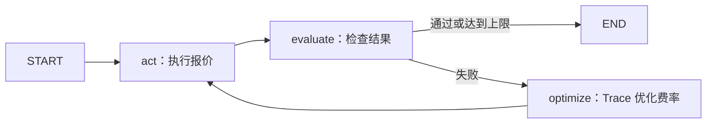

# 用 LangGraph + Microsoft Trace 学习 Agent

📱 **手机阅读：[学习报告：Python / TypeScript 核心代码对照](LEARNING_REPORT.md)**

TypeScript 编排版本见 [ts-demo/README.md](ts-demo/README.md)，支持本地 Ollama `qwen3.5:9b`，通过 Python 子进程调用真实 Microsoft Trace。

这个小项目演示：Agent 做一次尝试，环境检查结果，失败后根据反馈调整策略，再尝试。
这里的 Trace 指 [Microsoft Trace](https://github.com/microsoft/Trace)，安装名是 `trace-opt`，导入名是 `opto`。
它通过执行计算图和反馈优化参数；LangGraph 定义执行顺序和循环。代码没有使用 LangSmith。

## 1. 先运行

推荐 Python 3.11 或 3.12。在本目录打开 PowerShell：

```powershell
python -m venv .venv
.\.venv\Scripts\python.exe -m pip install -r requirements.txt
.\.venv\Scripts\python.exe demo.py
```

如果机器只有 Python Launcher，第一行用 `py -3.12 -m venv .venv`。
如果本目录已经有配置好的 `.venv`，直接运行最后一行。
不需要激活虚拟环境，也不需要 API Key。首次安装依赖需要联网。

预期关键输出：

```text
第 1 轮：rate=1，报价=7，通过=False
第 2 轮：rate=3，报价=11，通过=True
新样例：4kg 报价=17，期望=17
```

任务是计算运费：`报价 = 每公斤费用 × 重量 + 固定费用 5`。
初始每公斤费用错误地设成 1；训练样例为 2kg 应收 11。
反馈帮助优化器把费率改为 3。最后用未参与优化的 4kg 样例验证。
这只是一个教学任务；真实业务需要足够的训练、验证数据和可信的评估规则。

## 2. 先分清两个图



上面是 **LangGraph 控制流图**，回答“下一步执行什么”。

```text
rate（可训练参数） ──乘以 weight──> 中间结果 ──加 5──> quote
      ↑                                              │
      └──────── backward：传播失败反馈 ────────────────┘
```

这是 **Trace 计算依赖图**，回答“结果依赖哪些可修改参数”。
LangGraph 不会自动把它的控制流图变成 Trace 计算图；这里通过在 State 中保留 Trace Node 把两者连接起来。

## 3. 按这个顺序读 demo.py

1. `State`：一次任务的共享状态，包括重量、输出、尝试次数、反馈和历史。
2. `build_graph()` 中的 `rate`：`trainable=True` 表明它可以被优化。它存在闭包中，生命周期长于一次节点调用。
3. `act()`：调用报价运算。这里用确定性工具替代复杂的 LLM 行动选择，先学闭环。
4. `evaluate()`：环境给出对错及自然语言反馈，不直接修改参数。
5. `route()`：成功就结束，失败就优化；尝试次数防止无限循环。
6. `optimize()`：`zero_feedback → backward → step`，清理旧反馈、传播新反馈、更新参数。
7. `TeachingModel`：假模型返回 OptoPrime 要求的 JSON 建议。

**默认模式的边界：** TeachingModel 按已写好的规则解方程，因此结果稳定。
LangGraph 和 Trace 都是真实库，Trace 的反向反馈和参数更新也实际执行，但假模型没有自主推理能力。
这个例子是一个最小的 Agent 反馈闭环，不包含完整的 LLM 工具选择、长期记忆或生产部署。

**关键细节：** `quote.data` 只用于显示和评估。传给 `optimizer.backward()` 的是原来的 `quote` Node。
如果先把输出转成普通数字再重新包装，原始依赖链会丢失。
本例没有配置持久化 checkpoint；Trace Node 留在进程内的 State 中。
若以后加持久化，应单独设计可序列化状态与 Trace 执行对象的恢复方式。

## 4. 查看运行记录

运行后打开：

- `artifacts/run.json`：每轮参数、结果和新样例检查。
- `artifacts/graph.mmd`：LangGraph Mermaid 控制流图。
- `artifacts/optimizer.json`：OptoPrime 实际发给模型的计算依赖、参数、反馈，以及模型返回的建议。

建议先读 `optimizer.json` 中的 `user_prompt`，找到 `#Variables`、`#Code` 和 `#Feedback`，理解优化器看到了什么。

## 5. 使用本地 Ollama（你的 qwen3.5:9b）

确认 Ollama 已启动，直接运行：

```powershell
.\.venv\Scripts\python.exe demo.py --ollama
# 也可以指定模型与地址：
.\.venv\Scripts\python.exe demo.py --ollama --model qwen3.5:9b --base-url http://localhost:11434
```

这会让真实的 Qwen 模型阅读 Trace 的计算图和失败反馈，提出新费率。
通过 Ollama 原生 `/api/chat` 调用，无需 API Key。为简化 JSON 输出，关闭 thinking，温度设为 0。
模型建议不保证正确，仍由 evaluate 检查并由重试上限控制结束。
首次加载模型可能较慢；单次请求超时为 180 秒。

本机已实际验证 `qwen3.5:9b`：第 1、2 轮报价为 7，第 3 轮修正为 11，
4kg 新样例得到 17。第一次模型返回的建议字段格式有误，未更新参数；
第二次返回合法建议后才更新成功。你可以在 `artifacts/optimizer.json` 比较两次响应。
默认假模型的三个单元测试也已通过。真实模型每次运行可能出现不同过程。

接口依据：[Ollama Chat API](https://docs.ollama.com/api/chat)。

### 其他模型服务（可选）

Trace 默认通过 LiteLLM 调用模型。在 PowerShell 配置自己的服务：

```powershell
$env:TRACE_LITELLM_MODEL = '你的 LiteLLM 模型标识'
# 按服务要求设置相应的 API Key，例如 OPENAI_API_KEY 或 ANTHROPIC_API_KEY。
.\.venv\Scripts\python.exe demo.py --live
```

`--live` 只替换优化器中的假模型，报价工具仍然是确定性的。
模型标识和凭据要求参见 [LiteLLM 服务文档](https://docs.litellm.ai/docs/providers)。
真实调用会产生相应服务费用，结果不保证每次收敛；脚本会报告达到上限的情况。
本项目未包含密钥，也不会自动读取 `.env`。

## 6. 三个学习实验

1. 用 `--max-attempts 1` 运行：观察失败后直接结束，不执行优化。
2. 把初始 `rate` 改为 3：观察第一轮成功，不调用优化器。
3. 在真实模型模式下，把目标报价改为无法由整数费率产生的值：观察为什么评估规则与参数空间必须匹配。默认假模型只适用于本例的整数运费规则。

验证反馈传播、成功退出和尝试上限：

```powershell
.\.venv\Scripts\python.exe -m unittest -v
```

进一步可以把 `rate` 换成提示词参数，用 `@bundle` 包装 LLM 调用，并保持提示词 → 输出的 Trace 依赖。
再用多个样例做训练与验证，避免只记住单个答案。

## 参考

- [LangGraph StateGraph API](https://reference.langchain.com/python/langgraph/graph/state)
- [Trace 官方项目与示例](https://github.com/microsoft/Trace)
- [Trace OptoPrime 实现](https://github.com/microsoft/Trace/blob/main/opto/optimizers/optoprime.py)
