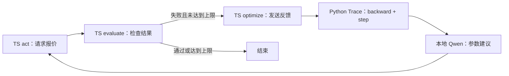

# TypeScript LangGraph + Microsoft Trace + 本地 Qwen

这是前一个 Python demo 的 TypeScript 编排版本，任务相同：根据失败反馈修正运费参数。

**技术边界：** LangGraph 的状态、节点、条件路由、重试与结果输出都写在 TypeScript 中。
Microsoft Trace 使用官方 Python `trace-opt`，通过一个子进程桥接调用。
这不是纯 TS 的 Trace 移植，也没有手写一个优化器来代替真实 Trace。
模型使用你本地 Ollama 的 `qwen3.5:9b`，不需要 API Key。

## 运行

本机父目录已经装好了 Python 虚拟环境，进入本文件夹：

```powershell
cd ts-demo
npm.cmd install
npm.cmd run demo
npm.cmd run demo:ollama
```

- `demo` 使用规则编写的教学假模型，便于稳定学习。
- `demo:ollama` 使用真实 Qwen，阅读 Trace 计算图并生成参数建议。

你也可以自定义：

```powershell
npm.cmd run demo -- --ollama --model qwen3.5:9b --base-url http://localhost:11434 --max-attempts 3
npm.cmd run check
npm.cmd test
```

要求 Node.js 22+，以及安装父目录 `requirements.txt` 的 Python 环境。
代码自动选择父目录 `.venv/Scripts/python.exe`。其他环境通过变量指定：

```powershell
$env:PYTHON_PATH = '你的 Python 可执行文件绝对路径'
npm.cmd run demo:ollama
```

请保留整个项目结构：`trace_worker.py` 会导入父目录 `demo.py` 中已经验证的模型适配器。
如果换机器，先在父目录创建虚拟环境并安装 `requirements.txt`。

## 发生了什么



运费公式是 `rate × weight + 5`。初始 `rate=1`，2kg 得到 7，但期望为 11。
Trace 把失败反馈传回可训练的 rate，优化器请求模型建议；成功时 rate 变成 3。
最后检查未参与优化的 4kg 样例，期望报价为 17。

关键代码按顺序读：

1. `src/demo.ts`：看 `Annotation.Root` 如何描述状态，以及三个节点和条件边如何组成循环。
2. `src/trace-client.ts`：看 TypeScript 如何启动 Python 子进程，用带 id 的 JSON Lines 匹配请求和响应。
3. `trace_worker.py`：看真正的 `node(trainable=True)`、`backward` 和 `step`。
4. `src/main.ts`：看运行参数、逐步日志和结果文件。

## 为什么需要 handle

Trace 需要原始计算依赖链：`rate → multiply → add → quote`。
不能把 Python Node 直接通过 JSON 传给 TS，也不能只传数值后重新包装。
所以 Python 保留真正的 quote Node，TS 状态只保存 `{ handle, value, rate }`。
调用优化时传回 handle，worker 找到原始 Node 后传播反馈。

每次运行独享一个 worker；结束后关闭进程。handle 仅在该 worker 本次运行期间有效，
不能作为可跨进程恢复的 checkpoint。这里的参数更新是单个任务内在线调整，尚未实现跨运行保存策略。

## 查看结果与做实验

运行后，当前文件夹的 `artifacts/` 中会生成：

- `run.json`：每轮参数、报价、通过情况和新样例结果。
- `optimizer.json`：真实 Trace 发给模型的提示与返回建议。
- `graph.mmd`：TypeScript LangGraph 的控制流图。

先用默认教学模式观察 7 → 11，再用 Ollama 比较返回建议。
真实模型可能给出无效建议，程序会继续检查；达到上限后如实报告失败。
可运行 `npm.cmd run demo -- --max-attempts 1`，观察为什么第一轮失败后直接结束。

默认模式的模型只是按规则解方程，不能把它的稳定输出视作模型学习效果。
Ollama 模式才由 Qwen 生成建议；即使单个新样例通过，也不足以证明真实业务的泛化能力。

本机验证结果：TypeScript 类型检查通过，4 个集成测试通过。
实际调用 `qwen3.5:9b` 时第 3 轮成功（报价 7 → 7 → 11），4kg 新样例为 17。
本次真实模型运行记录已保存在 `artifacts/`，后续运行会覆盖这些记录。

## 官方资料

- [LangGraph.js StateGraph](https://langchain-ai.github.io/langgraphjs/reference/classes/langgraph.StateGraph.html)
- [Microsoft Trace 官方 Python 项目](https://github.com/microsoft/Trace)
- [Ollama Chat API](https://docs.ollama.com/api/chat)
